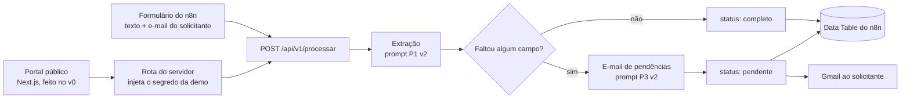
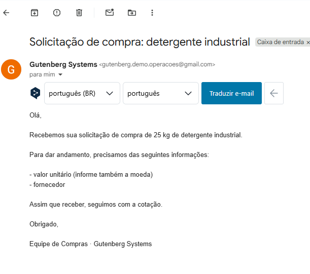

# API de Pedidos com IA · Gutenberg Systems

**Pedido de compra em texto livre vira dados prontos e um e-mail pedindo só o que faltou.** Uma API leve (JavaScript em funções da Vercel), integrada a um fluxo de automação no n8n e a um portal público, que usa um modelo de linguagem com validação, custo e limites controlados em código.

[Portal de demonstração](https://api-pedidos-portal.vercel.app) · [Código do portal](https://github.com/Prodigyb0y/api-pedidos-portal) · [API publicada](https://api-pedidos-mu.vercel.app) · [Especificação OpenAPI](https://api-pedidos-mu.vercel.app/api/openapi.json) · [Resultados medidos](docs/resultados_medicao.md) · [Prompt Lab](https://github.com/Prodigyb0y/prompt-lab)

> Projeto de portfólio com **empresa, pessoas e pedidos 100% fictícios** (Gutenberg Systems). Nenhum dado, nome ou sistema de empresa real.


<sub>Captura do Console publicado no portal, em 22/11/2026, com um pedido fictício processado de verdade (custo e tempo do modelo no topo do resultado). Foi tirada antes do ajuste que formata valor e data na aba Campos, por isso aparecem como `18.5` e `2026-12-15`; hoje o portal mostra `R$ 18,50` e `15/12/2026`.</sub>

## Em 30 segundos
| | |
|---|---|
| **O que faz** | Recebe um pedido de compra em texto livre e devolve 8 campos estruturados, a lista do que falta e o e-mail pedindo só o que faltou. |
| **Para quem** | Times de compras que hoje redigitam pedidos e escrevem e-mails de cobrança de informação à mão. |
| **Teste agora** | [Console do portal](https://api-pedidos-portal.vercel.app/console): 4 exemplos prontos, sem instalar nada e sem chave. |
| **Resultado medido** | Em 20 pedidos fictícios: 160 de 160 campos, 20 de 20 status e 10 de 10 e-mails corretos; mediana de 2,03 s e custo médio de US$ 0,000218 por pedido. Amostra pequena e uma rodada: [método e limites](docs/resultados_medicao.md). |
| **Controles** | Saída validada em código (nunca inventa), teto de gasto mensal, limite diário, idempotência e 28 testes sem chamar o modelo. |
| **Feito com** | API JavaScript na Vercel, modelo `claude-haiku-5-5`, n8n Cloud e um portal em Next.js gerado no v0. |
| **Autor** | Definiu o problema, o desenho e as regras; trouxe os prompts do seu Prompt Lab; revisou os casos de teste (escritos com ajuda de IA) e congelou o gabarito antes da medição; aprovou cada plano, testou e publicou. |
| **Com IA (Claude)** | Escreveu o código da API e montou o fluxo do n8n, a partir do desenho do autor. |
| **Com IA (v0)** | Gerou o portal em 3 etapas, com plano aprovado antes de cada código. Registro completo em [`docs/vibe_coding.md`](docs/vibe_coding.md). |

## Sumário
[Em 30 segundos](#em-30-segundos) · [Mapa dos repositórios](#mapa-dos-repositórios) · [A dor que resolve](#a-dor-que-resolve) · [Como resolve](#como-resolve) · [Resultados](#resultados) · [Arquitetura](#arquitetura) · [Tecnologias](#tecnologias) · [Decisões de projeto](#decisões-de-projeto) · [Glossário](#glossário-rápido) · [API](#api) · [Como rodar](#como-rodar) · [Estrutura](#estrutura-do-repositório) · [Limitações](#limitações) · [Como foi construído](#como-foi-construído) · [Conclusão](#conclusão)

## Mapa dos repositórios
O projeto tem dois repositórios que se complementam. **Este é o principal**: conta a história inteira (problema, resultados medidos, arquitetura e limitações).

| Repositório | Papel | Leia se você quer… |
|---|---|---|
| [`api-pedidos-ia`](https://github.com/Prodigyb0y/api-pedidos-ia) (este) | **A API**: lê o pedido em texto livre, valida e devolve os dados e o e-mail de pendências. Também guarda os prompts, os testes, a medição e o fluxo do n8n. | entender o problema, o resultado e as decisões técnicas |
| [`api-pedidos-portal`](https://github.com/Prodigyb0y/api-pedidos-portal) | **O portal**: site feito no v0 que mostra a API funcionando (console de teste, uso, documentação). Só consome a API. | ver a interface e como o v0 foi usado |

- **Leitura rápida (RH):** abra o [portal](https://api-pedidos-portal.vercel.app/console), teste um dos 4 exemplos e veja a seção [Resultados](#resultados) abaixo.
- **Leitura técnica:** [Arquitetura](#arquitetura), [Decisões de projeto](#decisões-de-projeto), os testes em [`test/`](test), o fluxo em [`docs/n8n.md`](docs/n8n.md) e o registro de uso de IA em [`docs/vibe_coding.md`](docs/vibe_coding.md).

## A dor que resolve
O time de compras recebe pedidos por e-mail ou mensagem, em texto livre. Para cada um, alguém redigita item, quantidade, unidade, prazo, valor e fornecedor numa planilha e, quando falta informação, escreve outro e-mail pedindo o que faltou. É trabalho repetitivo, sujeito a erro de digitação e lento.

## Como resolve
A API recebe o texto do pedido e devolve:
1. **8 campos estruturados** (área solicitante, item, quantidade, unidade, prazo, valor unitário, moeda e fornecedor);
2. **a lista do que falta**, com o `status` do pedido (`completo` ou `pendente`);
3. **o e-mail de pendências** já escrito, citando exatamente os campos que faltam.

O que não está no texto volta **vazio, nunca inventado**, para uma pessoa conferir. Cada resposta traz o custo da chamada, e a API tem teto de gasto mensal.

## Resultados
Medidos em 21/11/2026 com 20 pedidos fictícios (10 completos e 10 incompletos), gabarito escrito e registrado **antes** da execução, enviados pelo fluxo do n8n. Método, dados e limitações em [`docs/resultados_medicao.md`](docs/resultados_medicao.md).

| Medida | Resultado |
|---|---|
| Campos corretos | 160 de 160 |
| Status correto (completo ou pendente) | 20 de 20 |
| E-mails citando exatamente os campos faltantes | 10 de 10 |
| Tempo de execução no n8n (mediana) | 2,03 s |
| Custo por pedido (média) | US$ 0,000218 |

**Comparação com o processo manual (mesmos 5 pedidos):** o autor cronometrou à mão os pedidos C02, C07, I01, I04 e I06: média de 119 s por pedido e 38 de 40 campos corretos. Nesses mesmos 5 pedidos, a API acertou 40 de 40 campos e levou em média 2,29 s de execução no n8n (calculado com o mesmo pontuador). Os dois tempos não medem a mesma coisa (o da API é tempo de máquina no n8n; o manual inclui leitura e digitação), e a conferência humana dos pedidos pendentes não foi cronometrada. Os 160 de 160 da tabela acima valem para os 20 pedidos e não devem ser lidos contra os 38 de 40 do manual.

**Como ler estes números:** amostra pequena, uma rodada, casos escritos por um assistente de IA e revisados pelo autor. Não provam acerto geral. Os números do [Prompt Lab](https://github.com/Prodigyb0y/prompt-lab) são do laboratório, não desta API.

## O que este projeto demonstra
| Competência | Onde está a prova |
|---|---|
| **API leve** (expor, não só consumir) | 7 rotas com contrato [OpenAPI 3.1](https://api-pedidos-mu.vercel.app/api/openapi.json), autenticação por chave, limites e erros padronizados: seção [API](#api). |
| **Automação no n8n integrando IA a sistemas externos** | Fluxo com formulário, chamada à API, tabela e Gmail: [`docs/n8n.md`](docs/n8n.md) e [`n8n/fluxo_pedidos.json`](n8n/fluxo_pedidos.json). |
| **Prompt engineering em produção** | Prompts P1 v2 e P3 v2 versionados, conferidos por hash em teste e medidos no [Prompt Lab](https://github.com/Prodigyb0y/prompt-lab). |
| **Vibe coding (v0) com IA** | Portal gerado no v0 em 3 etapas com plano aprovado: [código público](https://github.com/Prodigyb0y/api-pedidos-portal) e registro de cada prompt em [`docs/vibe_coding.md`](docs/vibe_coding.md). |
| **Resultado de negócio mensurável** | Acerto, tempo e custo por pedido contra o processo manual, com gabarito congelado antes da execução: [`docs/resultados_medicao.md`](docs/resultados_medicao.md). |
| **Responsabilidade com custo e dados** | Teto de gasto, log sem o texto do pedido, dados 100% fictícios e limitações descritas abaixo. |

## Arquitetura

- O **n8n** recebe o pedido, chama a API com autenticação por cabeçalho, grava o resultado numa tabela e envia o e-mail quando o pedido está pendente. O desenho está em [`docs/n8n.md`](docs/n8n.md) e o fluxo exportado (sem credenciais) em [`n8n/fluxo_pedidos.json`](n8n/fluxo_pedidos.json).
- O **portal** é um app separado (código em [`api-pedidos-portal`](https://github.com/Prodigyb0y/api-pedidos-portal)) que só consome a API. O segredo da demo fica no servidor do portal e nunca chega ao navegador (conferido nos cabeçalhos, na resposta e no HTML).

## Tecnologias
| Camada | O que usa |
|---|---|
| API | Funções serverless da Vercel, Node 22, JavaScript puro e **sem dependências** |
| Modelo de linguagem | Anthropic `claude-haiku-5-5`, via API HTTP, com `effort: low` |
| Prompts | Dois prompts versionados e medidos no Prompt Lab (P1 v2 para extração, P3 v2 para o e-mail) |
| Persistência | Upstash Redis (contadores, teto de gasto, log sem conteúdo); em memória se não configurado |
| Automação | n8n Cloud: Form Trigger, HTTP Request, Data Table, IF e Gmail |
| Interface | Next.js gerado no v0, publicado na Vercel |
| Contrato e testes | OpenAPI 3.1 e 28 testes com `node:test` (sem chamar a Anthropic) |

## Decisões de projeto
- **Saída conferida em código.** O JSON passa por validação estrita; o e-mail só é aceito se citar exatamente os campos que faltam. Se não passar, uma nova tentativa; falhando de novo, erro 502 com o motivo, nunca dado aproximado.
- **Custo sob controle.** Antes de cada chamada, a API reserva o custo máximo; se o total do mês passar de `TETO_GASTO_USD`, responde 503 sem chamar o modelo. Há também limite diário por chave (429).
- **Idempotência.** Com `x-id-pedido`, o mesmo pedido reenviado em 24 h devolve a resposta anterior sem novo custo.
- **Segurança.** `x-api-key` comparada em tempo constante; segredos só em variáveis de ambiente; corpo limitado a 8 KB; log sem o texto do pedido e sem e-mail.
- **Prompts sem alteração.** Copiados do Prompt Lab e conferidos por hash em teste. Mudar um prompt exige nova medição.

## Glossário rápido
- **API:** um serviço que outros programas chamam pela internet. Aqui, o n8n e o portal enviam o texto do pedido e recebem a resposta pronta.
- **n8n:** ferramenta de automação visual. Liga o formulário de pedidos à API, grava o resultado em tabela e envia o e-mail.
- **Teto de gasto:** limite mensal de custo com o modelo de IA, aplicado no código; passou do teto, a API para de chamar o modelo.
- **Idempotência:** reenviar o mesmo pedido (mesmo `x-id-pedido`) em até 24 h devolve a resposta anterior, sem nova cobrança.
- **Campo vazio, nunca inventado:** se o dado não está no texto, o campo volta `null` para uma pessoa conferir.
- **Gabarito:** respostas corretas escritas antes de rodar a medição, para não ajustar a conta depois de ver o resultado.

## API
| Rota | Chave | O que faz |
|---|---|---|
| `GET /api/v1/saude` | não | Status, versão, modelo e versões dos prompts |
| `POST /api/v1/extrair` | sim | Texto do pedido → 8 campos em JSON + lista do que falta |
| `POST /api/v1/email-pendencias` | sim | Campos extraídos → e-mail citando **exatamente** os campos que faltam |
| `POST /api/v1/processar` | sim | Os dois em sequência; `status` = `completo` ou `pendente` (rota usada pelo n8n) |
| `GET /api/v1/uso` | não | Totais de chamadas, custo e latência (sem conteúdo de pedido) |
| `GET /api/openapi.json` | não | Especificação OpenAPI 3.1 |
| `POST /api/demo` | não | Rota da página de demonstração, com limite diário próprio e texto até 1.000 caracteres |

Campos extraídos: `solicitante_area`, `item`, `quantidade`, `unidade` (`un`, `kg`, `m`, `l`, `cx`), `prazo_entrega` (AAAA-MM-DD), `valor_unitario`, `moeda` (`BRL`, `USD`, `EUR`), `fornecedor`. O e-mail sabe pedir: área solicitante, prazo de entrega, valor unitário (com a moeda) e fornecedor.

### Exemplo
```bash
curl -X POST https://api-pedidos-mu.vercel.app/api/v1/processar \
  -H "content-type: application/json" \
  -H "x-api-key: SUA_CHAVE" \
  -H "x-id-pedido: msg-123" \
  -d '{"texto":"O Almoxarifado precisa de 25 kg de detergente industrial até 05/01/2027."}'
```
Resposta (resumida):
```json
{
  "status": "pendente",
  "dados": { "solicitante_area": "Almoxarifado", "item": "detergente industrial", "quantidade": 25, "unidade": "kg",
             "prazo_entrega": "2027-01-05", "valor_unitario": null, "moeda": null, "fornecedor": null },
  "faltantes": ["valor_unitario", "fornecedor"],
  "email": { "assunto": "...", "corpo": "...", "campos_citados": ["fornecedor", "valor_unitario"] },
  "modelo": "claude-haiku-5-5", "custo_usd": 0.00028, "chamadas_ao_modelo": 2
}
```
**Exemplo do e-mail gerado** (pedido do `curl` acima, recebido na caixa de entrada pelo fluxo do n8n):



O corpo do e-mail pede só o que faltou:

> Olá,
>
> Recebemos sua solicitação de compra de 25 kg de detergente industrial.
>
> Para dar andamento, precisamos das seguintes informações:
>
> - valor unitário (informe também a moeda)
> - fornecedor
>
> Assim que receber, seguimos com a cotação.
>
> Obrigado,
> Equipe de Compras · Gutenberg Systems

A redação muda um pouco a cada execução do modelo; o que o código garante é que o e-mail cite exatamente os campos em `faltantes`. Há outros e-mails reais, com os respectivos pedidos, em [`medicao/resultados_brutos.json`](medicao/resultados_brutos.json).

As rotas com chave exigem o cabeçalho `x-api-key`. Para testar sem chave, use o [portal](https://api-pedidos-portal.vercel.app/console).

### Erros
Toda falha volta como `{"erro":{"codigo":"...","mensagem":"..."}}`.

| HTTP | `codigo` | Quando acontece |
|---|---|---|
| 400 | `entrada_invalida`, `json_invalido`, `id_pedido_invalido` | JSON malformado, campo `texto` ausente ou fora de 10 a 4.000 caracteres (1.000 na rota da demo), campo extra ou `x-id-pedido` inválido |
| 401 | `chave_ausente` | Faltou o cabeçalho `x-api-key` |
| 403 | `chave_invalida` | Chave não reconhecida |
| 405 | `metodo_nao_permitido` | Método HTTP errado para a rota |
| 413 / 415 | `corpo_grande_demais`, `tipo_invalido` | Corpo acima de 8 KB ou sem `content-type: application/json` |
| 422 | `pedido_sem_item` | O texto não traz item e quantidade (não parece um pedido) |
| 429 | `limite_diario` | Limite diário da chave atingido |
| 502 | `saida_invalida`, `email_invalido`, `falha_provedor` | O modelo não devolveu JSON ou e-mail válidos após uma nova tentativa, ou o provedor falhou |
| 503 | `teto_de_gasto`, `api_nao_configurada`, `provedor_nao_configurado` | Teto mensal atingido ou API sem chaves configuradas |
| 500 | `erro_interno` | Falha inesperada |

## Como rodar
**Na Vercel (recomendado):** importe o repositório em vercel.com → Add New → Project, cadastre as variáveis abaixo (Production e Preview) e publique. Cada push em `main` publica de novo.

| Variável | Para que serve |
|---|---|
| `ANTHROPIC_API_KEY` | Chave da Anthropic (só no servidor) |
| `API_KEYS` | `apelido:segredo` separados por vírgula (segredo com 12+ caracteres), ex.: `n8n:...,demo:...` |
| `TETO_GASTO_USD` | Teto do mês com o modelo (padrão `0.50`) |
| `LIMITE_DIARIO_POR_CHAVE` | Chamadas por dia por chave (padrão `200`) |
| `LIMITE_DIARIO_DEMO` | Chamadas por dia na página de demonstração (padrão `30`) |
| `UPSTASH_REDIS_REST_URL` e `UPSTASH_REDIS_REST_TOKEN` | Opcional. Integração Upstash Redis da Vercel: deixa contadores, teto e log persistentes. Sem ela, ficam em memória por instância (a rota `/api/v1/uso` avisa) |

Variáveis alteradas depois do deploy só valem após um novo deploy (Redeploy).

**Testes (sem chamar a API da Anthropic):**
```bash
npm test
```
Os 28 testes cobrem autenticação, validação, cálculo de custo, teto de gasto, limite diário, idempotência, conferência do e-mail, log sem conteúdo, cliente do modelo e hash dos prompts.

**Fluxo no n8n:** importe [`n8n/fluxo_pedidos.json`](n8n/fluxo_pedidos.json) (Workflows → Import from file), crie a tabela `pedidos_processados`, a credencial Header Auth (`x-api-key` com o segredo `n8n`) e a conta do Gmail. O formulário de produção usado nos testes foi **despublicado em 22/11/2026**, porque aceitava qualquer e-mail como destino; a demonstração pública é o portal.

## Estrutura do repositório
```
api/               funções da Vercel (uma por rota)
lib/               regras: validação, autenticação, custo, controle (teto, limites, log), serviço, OpenAPI
prompts/           prompts copiados do Prompt Lab (fonte da verdade)
scripts/           gera lib/prompts.js a partir de prompts/
public/            página de demonstração da própria API
test/              testes com node:test
n8n/               fluxo exportado, sem credenciais
medicao/           gabarito dos 20 pedidos, resultados e script de pontuação
docs/              n8n, método e resultados da medição, registro de como foi construído
```

## Limitações
- Dados e pedidos fictícios; um único modelo; prompts medidos em casos gerados pelo autor do Prompt Lab.
- A medição tem 20 pedidos e uma rodada; a comparação manual tem 5 cronometragens, feitas pelo autor.
- A rota `GET /api/v1/uso` conta como erro toda resposta diferente de 200, inclusive chave ausente ou errada (401/403), pedido sem item (422) e limites (429/503); ela não mostra o código. O erro registrado em 22/11/2026 (1 em 31 chamadas) coincide com um teste de chave antiga feito pelo autor, mas isso não pode ser confirmado pelo endpoint. Detalhes em [`docs/uso_e_custo.md`](docs/uso_e_custo.md).
- `gasto_do_mes_usd` (contador do teto) e `mes.custo_usd` (soma do log) diferem em frações de centavo por construção; explicação em [`docs/uso_e_custo.md`](docs/uso_e_custo.md).
- Sem a integração de Redis, limites e teto valem por instância, não para a API inteira.
- O e-mail pede só quatro campos (área, prazo, valor com moeda e fornecedor); unidade e moeda sozinhas não geram pedido de informação.
- A conferência do e-mail é por nome exato do campo: um e-mail correto escrito com outro nome seria recusado.
- No fluxo do n8n, um texto que não é pedido (422) é registrado com o status `pedido_sem_item` (confirmado em execução manual do n8n em 22/11/2026), mas o solicitante não recebe resposta; e pedido completo não gera aviso para Compras (detalhes em [`docs/n8n.md`](docs/n8n.md)).
- Do portal, só foram verificados por inspeção e teclado: abas, link de salto, rótulos e `aria-live`. Não houve teste com leitor de tela, movimento reduzido nem a ordem completa do Tab.

## Como foi construído
Código da API escrito com um assistente de código de IA (Claude), a partir do desenho e das regras definidos pelo autor. A primeira tentativa de base no v0 foi abandonada; o v0 acabou sendo usado na camada de interface: o portal foi gerado nele, em um app separado que consome esta API, em três etapas com plano aprovado antes de cada código. O fluxo do n8n foi montado por um assistente de IA (Claude), pelas ferramentas do n8n, a partir do desenho do autor, e testado e publicado por ele. O registro de cada etapa, com o que foi verificado e o que não foi, está em [`docs/vibe_coding.md`](docs/vibe_coding.md).

## Conclusão
O projeto entrega, de ponta a ponta, o que se propôs: um pedido de compra em texto livre entra pelo formulário do n8n ou pelo portal, passa pela API e sai como 8 campos estruturados, a lista do que falta e um e-mail pedindo só o que faltou, com custo medido por pedido.

**Concluído e comprovado**
- **API publicada** com 7 rotas, contrato OpenAPI 3.1, autenticação por chave, teto de gasto, limite diário e idempotência, coberta por 28 testes que não chamam o modelo.
- **Medição em 20 pedidos fictícios**, com gabarito registrado antes da execução: 160 de 160 campos, 20 de 20 status e 10 de 10 e-mails corretos, mediana de 2,03 s e custo médio de US$ 0,000218 por pedido. Nos 5 pedidos cronometrados à mão, o processo manual levou em média 119 s e a API 2,29 s de execução no n8n (medidas de natureza diferente, como explicado em [Resultados](#resultados)).
- **Fluxo no n8n testado**: pedido incompleto gera o e-mail certo e uma linha na tabela; texto que não é pedido é registrado como `pedido_sem_item`, sem e-mail.
- **Portal público feito no v0**, com o segredo da demo só no servidor e 16 testes passando com as versões travadas no `pnpm-lock.yaml`.
- **Dois repositórios públicos**, sem chaves ou segredos, com os prompts P1 v2 e P3 v2 sem alteração.

**Alcance dos resultados:** amostra de 20 pedidos em uma rodada, casos escritos com ajuda de IA e revisados pelo autor, comparação manual com 5 cronometragens, portal sem teste com leitor de tela e formulário de produção do n8n despublicado. Esses limites estão em [Limitações](#limitações). Os números do [Prompt Lab](https://github.com/Prodigyb0y/prompt-lab) são do laboratório, não desta API.
