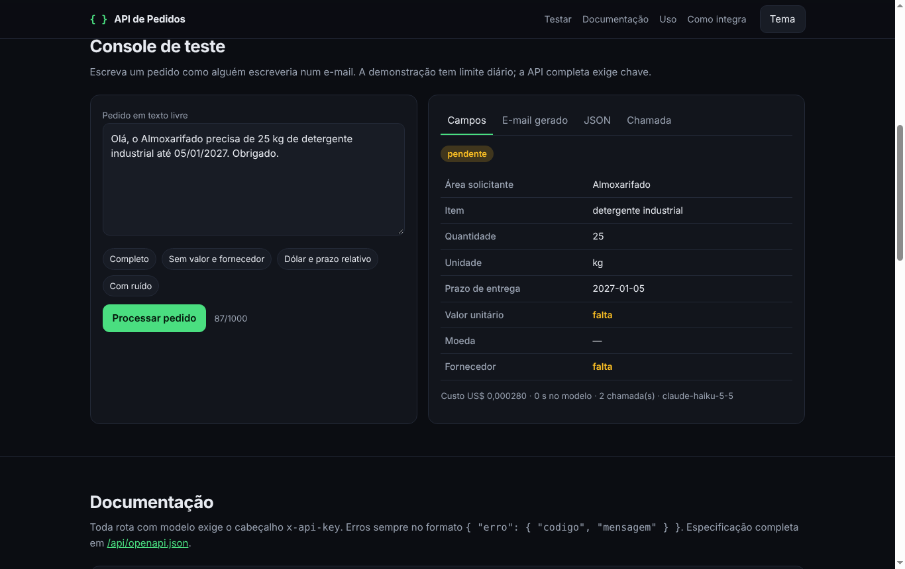
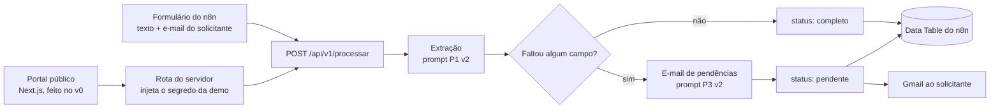

# API de Pedidos com IA · Gutenberg Systems

**Pedido de compra em texto livre vira dados prontos e um e-mail pedindo só o que faltou.** Uma API leve (JavaScript em funções da Vercel), integrada a um fluxo de automação no n8n e a um portal público, que usa um modelo de linguagem com validação, custo e limites controlados em código.

[Portal de demonstração](https://api-pedidos-portal.vercel.app) · [API publicada](https://api-pedidos-mu.vercel.app) · [Especificação OpenAPI](https://api-pedidos-mu.vercel.app/api/openapi.json) · [Resultados medidos](docs/resultados_medicao.md) · [Prompt Lab](https://github.com/Prodigyb0y/prompt-lab)

> Projeto de portfólio com **empresa, pessoas e pedidos 100% fictícios** (Gutenberg Systems). Nenhum dado, nome ou sistema de empresa real.


<sub>Captura do Console publicado no portal, em 22/11/2026, com um pedido fictício processado de verdade (custo e tempo do modelo no topo do resultado). Foi tirada antes do ajuste que formata valor e data na aba Campos, por isso aparecem como `18.5` e `2026-12-15`; hoje o portal mostra `R$ 18,50` e `15/12/2026`.</sub>

## Sumário
[A dor que resolve](#a-dor-que-resolve) · [Como resolve](#como-resolve) · [Resultados](#resultados) · [Arquitetura](#arquitetura) · [Tecnologias](#tecnologias) · [Decisões de projeto](#decisões-de-projeto) · [API](#api) · [Como rodar](#como-rodar) · [Estrutura](#estrutura-do-repositório) · [Limitações](#limitações) · [Como foi construído](#como-foi-construído)

## A dor que resolve
O time de compras recebe pedidos por e-mail ou mensagem, em texto livre. Para cada um, alguém redigita item, quantidade, unidade, prazo, valor e fornecedor numa planilha e, quando falta informação, escreve outro e-mail pedindo o que faltou. É trabalho repetitivo, sujeito a erro de digitação e lento.

## Como resolve
A API recebe o texto do pedido e devolve:
1. **8 campos estruturados** (área solicitante, item, quantidade, unidade, prazo, valor unitário, moeda e fornecedor);
2. **a lista do que falta**, com o `status` do pedido (`completo` ou `pendente`);
3. **o e-mail de pendências** já escrito, citando exatamente os campos que faltam.

O que não está no texto volta **vazio, nunca inventado**, para uma pessoa conferir. Cada resposta traz o custo da chamada, e a API tem teto de gasto mensal.

## Resultados
Medidos em 21/11/2026 com 20 pedidos fictícios (10 completos e 10 incompletos), gabarito escrito e registrado **antes** da execução, enviados pelo fluxo do n8n. Método, dados e limitações em [`docs/resultados_medicao.md`](docs/resultados_medicao.md).

| Medida | Resultado |
|---|---|
| Campos corretos | 160 de 160 |
| Status correto (completo ou pendente) | 20 de 20 |
| E-mails citando exatamente os campos faltantes | 10 de 10 |
| Tempo de execução no n8n (mediana) | 2,03 s |
| Custo por pedido (média) | US$ 0,000218 |

**Comparação com o processo manual (mesmos 5 pedidos):** o autor cronometrou à mão os pedidos C02, C07, I01, I04 e I06: média de 119 s por pedido e 38 de 40 campos corretos. Nesses mesmos 5 pedidos, a API acertou 40 de 40 campos e levou em média 2,29 s de execução no n8n (calculado com o mesmo pontuador). Os dois tempos não medem a mesma coisa (o da API é tempo de máquina no n8n; o manual inclui leitura e digitação), e a conferência humana dos pedidos pendentes não foi cronometrada. Os 160 de 160 da tabela acima valem para os 20 pedidos e não devem ser lidos contra os 38 de 40 do manual.

**Como ler estes números:** amostra pequena, uma rodada, casos escritos por um assistente de IA e revisados pelo autor. Não provam acerto geral. Os números do [Prompt Lab](https://github.com/Prodigyb0y/prompt-lab) são do laboratório, não desta API.

## Arquitetura

- O **n8n** recebe o pedido, chama a API com autenticação por cabeçalho, grava o resultado numa tabela e envia o e-mail quando o pedido está pendente. O desenho está em [`docs/n8n.md`](docs/n8n.md) e o fluxo exportado (sem credenciais) em [`n8n/fluxo_pedidos.json`](n8n/fluxo_pedidos.json).
- O **portal** é um app separado que só consome a API. O segredo da demo fica no servidor do portal e nunca chega ao navegador (conferido nos cabeçalhos, na resposta e no HTML).

## Tecnologias
| Camada | O que usa |
|---|---|
| API | Funções serverless da Vercel, Node 22, JavaScript puro e **sem dependências** |
| Modelo de linguagem | Anthropic `claude-haiku-5-5`, via API HTTP, com `effort: low` |
| Prompts | Dois prompts versionados e medidos no Prompt Lab (P1 v2 para extração, P3 v2 para o e-mail) |
| Persistência | Upstash Redis (contadores, teto de gasto, log sem conteúdo); em memória se não configurado |
| Automação | n8n Cloud: Form Trigger, HTTP Request, Data Table, IF e Gmail |
| Interface | Next.js gerado no v0, publicado na Vercel |
| Contrato e testes | OpenAPI 3.1 e 28 testes com `node:test` (sem chamar a Anthropic) |

## Decisões de projeto
- **Saída conferida em código.** O JSON passa por validação estrita; o e-mail só é aceito se citar exatamente os campos que faltam. Se não passar, uma nova tentativa; falhando de novo, erro 502 com o motivo, nunca dado aproximado.
- **Custo sob controle.** Antes de cada chamada, a API reserva o custo máximo; se o total do mês passar de `TETO_GASTO_USD`, responde 503 sem chamar o modelo. Há também limite diário por chave (429).
- **Idempotência.** Com `x-id-pedido`, o mesmo pedido reenviado em 24 h devolve a resposta anterior sem novo custo.
- **Segurança.** `x-api-key` comparada em tempo constante; segredos só em variáveis de ambiente; corpo limitado a 8 KB; log sem o texto do pedido e sem e-mail.
- **Prompts sem alteração.** Copiados do Prompt Lab e conferidos por hash em teste. Mudar um prompt exige nova medição.

## API
| Rota | Chave | O que faz |
|---|---|---|
| `GET /api/v1/saude` | não | Status, versão, modelo e versões dos prompts |
| `POST /api/v1/extrair` | sim | Texto do pedido → 8 campos em JSON + lista do que falta |
| `POST /api/v1/email-pendencias` | sim | Campos extraídos → e-mail citando **exatamente** os campos que faltam |
| `POST /api/v1/processar` | sim | Os dois em sequência; `status` = `completo` ou `pendente` (rota usada pelo n8n) |
| `GET /api/v1/uso` | não | Totais de chamadas, custo e latência (sem conteúdo de pedido) |
| `GET /api/openapi.json` | não | Especificação OpenAPI 3.1 |
| `POST /api/demo` | não | Rota da página de demonstração, com limite diário próprio e texto até 1.000 caracteres |

Campos extraídos: `solicitante_area`, `item`, `quantidade`, `unidade` (`un`, `kg`, `m`, `l`, `cx`), `prazo_entrega` (AAAA-MM-DD), `valor_unitario`, `moeda` (`BRL`, `USD`, `EUR`), `fornecedor`. O e-mail sabe pedir: área solicitante, prazo de entrega, valor unitário (com a moeda) e fornecedor.

### Exemplo
```bash
curl -X POST https://api-pedidos-mu.vercel.app/api/v1/processar \
  -H "content-type: application/json" \
  -H "x-api-key: SUA_CHAVE" \
  -H "x-id-pedido: msg-123" \
  -d '{"texto":"O Almoxarifado precisa de 25 kg de detergente industrial até 05/01/2027."}'
```
Resposta (resumida):
```json
{
  "status": "pendente",
  "dados": { "solicitante_area": "Almoxarifado", "item": "detergente industrial", "quantidade": 25, "unidade": "kg",
             "prazo_entrega": "2027-01-05", "valor_unitario": null, "moeda": null, "fornecedor": null },
  "faltantes": ["valor_unitario", "fornecedor"],
  "email": { "assunto": "...", "corpo": "...", "campos_citados": ["fornecedor", "valor_unitario"] },
  "modelo": "claude-haiku-5-5", "custo_usd": 0.00028, "chamadas_ao_modelo": 2
}
```
As rotas com chave exigem o cabeçalho `x-api-key`. Para testar sem chave, use o [portal](https://api-pedidos-portal.vercel.app/console).

## Como rodar
**Na Vercel (recomendado):** importe o repositório em vercel.com → Add New → Project, cadastre as variáveis abaixo (Production e Preview) e publique. Cada push em `main` publica de novo.

| Variável | Para que serve |
|---|---|
| `ANTHROPIC_API_KEY` | Chave da Anthropic (só no servidor) |
| `API_KEYS` | `apelido:segredo` separados por vírgula (segredo com 12+ caracteres), ex.: `n8n:...,demo:...` |
| `TETO_GASTO_USD` | Teto do mês com o modelo (padrão `0.50`) |
| `LIMITE_DIARIO_POR_CHAVE` | Chamadas por dia por chave (padrão `200`) |
| `LIMITE_DIARIO_DEMO` | Chamadas por dia na página de demonstração (padrão `30`) |
| `UPSTASH_REDIS_REST_URL` e `UPSTASH_REDIS_REST_TOKEN` | Opcional. Integração Upstash Redis da Vercel: deixa contadores, teto e log persistentes. Sem ela, ficam em memória por instância (a rota `/api/v1/uso` avisa) |

Variáveis alteradas depois do deploy só valem após um novo deploy (Redeploy).

**Testes (sem chamar a API da Anthropic):**
```bash
npm test
```
Os 28 testes cobrem autenticação, validação, cálculo de custo, teto de gasto, limite diário, idempotência, conferência do e-mail, log sem conteúdo, cliente do modelo e hash dos prompts.

**Fluxo no n8n:** importe [`n8n/fluxo_pedidos.json`](n8n/fluxo_pedidos.json) (Workflows → Import from file), crie a tabela `pedidos_processados`, a credencial Header Auth (`x-api-key` com o segredo `n8n`) e a conta do Gmail. O formulário de produção usado nos testes foi **despublicado em 22/11/2026**, porque aceitava qualquer e-mail como destino; a demonstração pública é o portal.

## Estrutura do repositório
```
api/               funções da Vercel (uma por rota)
lib/               regras: validação, autenticação, custo, controle (teto, limites, log), serviço, OpenAPI
prompts/           prompts copiados do Prompt Lab (fonte da verdade)
scripts/           gera lib/prompts.js a partir de prompts/
public/            página de demonstração da própria API
test/              testes com node:test
n8n/               fluxo exportado, sem credenciais
medicao/           gabarito dos 20 pedidos, resultados e script de pontuação
docs/              n8n, plano e resultados da medição, registro de como foi construído
```

## Limitações
- Dados e pedidos fictícios; um único modelo; prompts medidos em casos gerados pelo autor do Prompt Lab.
- A medição tem 20 pedidos e uma rodada; a comparação manual tem 5 cronometragens, feitas pelo autor.
- A rota `GET /api/v1/uso` conta como erro toda resposta diferente de 200, inclusive chave ausente ou errada (401/403), pedido sem item (422) e limites (429/503); ela não mostra o código. O erro registrado em 22/11/2026 (1 em 31 chamadas) coincide com um teste de chave antiga feito pelo autor, mas isso não pode ser confirmado pelo endpoint. Detalhes em [`docs/uso_e_custo.md`](docs/uso_e_custo.md).
- `gasto_do_mes_usd` (contador do teto) e `mes.custo_usd` (soma do log) diferem em frações de centavo por construção; explicação em [`docs/uso_e_custo.md`](docs/uso_e_custo.md).
- Sem a integração de Redis, limites e teto valem por instância, não para a API inteira.
- O e-mail pede só quatro campos (área, prazo, valor com moeda e fornecedor); unidade e moeda sozinhas não geram pedido de informação.
- A conferência do e-mail é por nome exato do campo: um e-mail correto escrito com outro nome seria recusado.
- No fluxo do n8n, um texto que não é pedido (422) é registrado, mas o solicitante não recebe resposta; e pedido completo não gera aviso para Compras (detalhes em [`docs/n8n.md`](docs/n8n.md)).
- Do portal, só foram verificados por inspeção e teclado: abas, link de salto, rótulos e `aria-live`. Não houve teste com leitor de tela, movimento reduzido nem a ordem completa do Tab.

## Como foi construído
Código da API escrito com um assistente de código de IA (Claude), a partir do desenho e das regras definidos pelo autor. A primeira tentativa de base no v0 foi abandonada; o v0 acabou sendo usado na camada de interface: o portal foi gerado nele, em um app separado que consome esta API, em três etapas com plano aprovado antes de cada código. O fluxo do n8n foi montado por um assistente de IA (Claude), pelas ferramentas do n8n, a partir do desenho do autor, e testado e publicado por ele. O registro de cada etapa, com o que foi verificado e o que não foi, está em [`docs/vibe_coding.md`](docs/vibe_coding.md).
